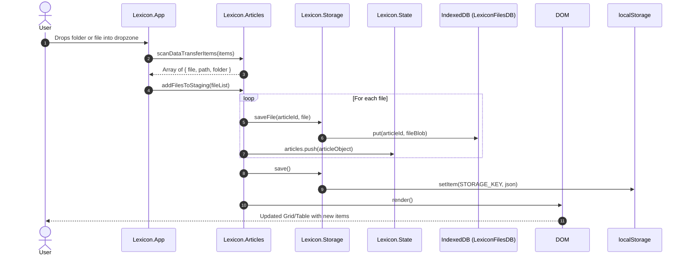
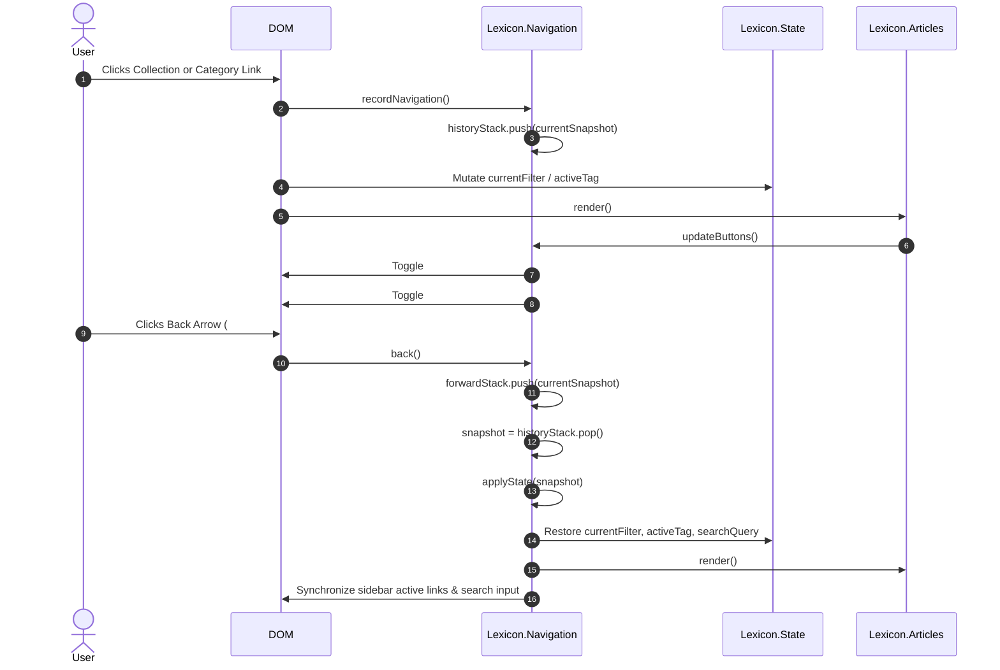

# Lexicon Architecture & Technical Specification

> **Target Audience:** Senior Software Engineers, Systems Architects, and Technical Contributors.  
> **Scope:** Full-codebase deep dive into Lexicon v2 (Architecture, Design Patterns, Data Models, State Lifecycles, Storage Subsystems, and Performance Invariants).

---

## 📑 Table of Contents

1. [Architectural Overview & Engineering Philosophy](#1-architectural-overview--engineering-philosophy)
2. [System Topology & High-Level Flow](#2-system-topology--high-level-flow)
3. [Core Architectural Patterns](#3-core-architectural-patterns)
4. [Data Model & Type Definitions](#4-data-model--type-definitions)
5. [Deep-Dive Module Walkthrough](#5-deep-dive-module-walkthrough)
   - [5.1 State Machine (`js/state.js`)](#51-state-machine-jsstatejs)
   - [5.2 Two-Tier Storage Engine (`js/storage.js`)](#52-two-tier-storage-engine-jsstoragejs)
   - [5.3 SPA Navigation & History Stack (`js/navigation.js`)](#53-spa-navigation--history-stack-jsnavigationjs)
   - [5.4 Collections & Folder Subsystem (`js/collections.js`)](#54-collections--folder-subsystem-jscollectionsjs)
   - [5.5 Document Engine & Inspector (`js/articles.js`)](#55-document-engine--inspector-jsarticlesjs)
   - [5.6 Application Lifecycle & Event Dispatcher (`js/app.js`)](#56-application-lifecycle--event-dispatcher-jsappjs)
   - [5.7 UI Utilities (`js/ui/modal.js`, `js/ui/toast.js`)](#57-ui-utilities-jsuimodaljs-jsuitoastjs)
   - [5.8 CSS Architecture & Design Tokens (`css/styles.css`)](#58-css-architecture--design-tokens-cssstylescss)
6. [Data Lifecycles & Execution Sequences](#6-data-lifecycles--execution-sequences)
7. [Performance, Memory & Concurrency Invariants](#7-performance-memory--concurrency-invariants)
8. [Security & Sandbox Isolation](#8-security--sandbox-isolation)
9. [Technical Debt, Extensibility & Future Roadmap](#9-technical-debt-extensibility--future-roadmap)

---

## 1. Architectural Overview & Engineering Philosophy

Lexicon v2 is a **local-first, zero-build, offline-capable Single Page Application (SPA)** written in modular Vanilla ECMAScript 2020+.

### Core Tenets

1. **Zero-Build Portability:** No `npm install`, Webpack, Vite, or Babel step. The source code running in the browser is the exact source code in the repository. It can be served from any static file server (Python, Nginx, Node) or inspected directly via the Developer Console.
2. **Deterministic Two-Tier Storage:**
   - *Metadata & Relational Structure:* Synchronous, serializable JSON kept in `localStorage` (~5MB budget reserved exclusively for text-based catalog entities, notes, and user preferences).
   - *Binary File Blobs:* Asynchronous storage in browser `IndexedDB` (`LexiconFilesDB`), enabling multi-gigabyte local PDF/EPUB storage with no Base64 serialization overhead.
3. **Native Engine Delegation over Heavy Embeds:** Instead of bundling a 5MB+ PDF.js WASM canvas renderer with sluggish scrolling, Lexicon generates ephemeral `Blob` URLs (`blob:http://...`) and delegates rendering to the browser’s built-in PDF viewer tab. This yields hardware-accelerated text selection, GPU-backed vector rasterization, print subsystems, and native search.
4. **Predictable Unidirectional Event Flow:** View mutations follow a straightforward cycle: **DOM Event → Controller Method → Global State Mutation → Storage Sync → Explicit DOM Re-render**.

---

## 2. System Topology & High-Level Flow

```
+-------------------------------------------------------------------------------+
|                                  USER BROWSER                                 |
|                                                                               |
|  +-------------------+        +--------------------+        +---------------+ |
|  |     DOM / UI      | <----> |   Lexicon.App      | <----> | Lexicon.State | |
|  | (Grid/Table/Modal)|        | (Event Controller) |        | (Single Store)| |
|  +-------------------+        +--------------------+        +---------------+ |
|          ^                              |                           |         |
|          |                              v                           v         |
|  +-------------------+        +--------------------+        +---------------+ |
|  | Lexicon.Articles  |        | Lexicon.Navigation |        |Lexicon.Storage| |
|  | Lexicon.Collection|        |  (History Stacks)  |        +---------------+ |
|  +-------------------+        +--------------------+           |        |     |
+----------------------------------------------------------------|--------|-----+
                                                                 |        |
                                            +--------------------+        |
                                            v                             v
                                  +-------------------+         +---------------+
                                  |   localStorage    |         |   IndexedDB   |
                                  | (Catalog / Notes) |         | (Binary Blobs)|
                                  +-------------------+         +---------------+
```

---

## 3. Core Architectural Patterns

### 3.1 Global Namespace & IIFE Modules
Each script uses an Immediately Invoked Function Expression (IIFE) closing over private variables and attaching its public API to `window.Lexicon`:

```javascript
window.Lexicon = window.Lexicon || {};

(function() {
    // Private module scope
    const privateRegistry = new Map();

    // Exported controller
    window.Lexicon.ModuleName = {
        publicMethod() { ... }
    };
})();
```

### 3.2 State Immutability vs Direct Mutation
State resides in `window.Lexicon.State`. While properties are mutated directly by controllers, snapshots for navigation and storage serialization use deep cloning (`JSON.parse(JSON.stringify(...))`) to prevent accidental reference leakage.

### 3.3 Templating without Virtual DOM
HTML fragments are constructed using ES6 Template Literals with string concatenation (`array.map(...).join('')`) and injected via `innerHTML`. Event delegation or inline `onclick="Lexicon.Module.action(...)"` handlers connect markup to controller routines. This eliminates virtual DOM diffing overhead for collections under 10,000 items.

---

## 4. Data Model & Type Definitions

Below are the TypeScript-equivalent interface definitions governing the application's domain model:

```typescript
/** Unique identifier for articles: epoch milliseconds (number) */
type ArticleId = number;

/** Unique identifier for collections: prefixed string, e.g. "c_1700000000" */
type CollectionId = string;

/** Pipeline workflow state */
type ArticleStatus = 'inbox' | 'reading' | 'processing' | 'archived';

/** Document file visual indicator */
type CoverType = 'pdf' | 'book' | 'doc';

/** Primary Document Entity */
interface Article {
    id: ArticleId;
    title: string;
    authors: string;
    year: number;
    publication: string;
    doi: string;
    status: ArticleStatus;
    collection: string | null;      // Collection name or null for unfiled
    tags: string[];                 // Array of string labels without '#' prefix
    addedDate: string;              // ISO Date "YYYY-MM-DD"
    isFavorite: boolean;
    coverType: CoverType;
    fileName: string;
    fileSize: string;               // Human-readable, e.g. "4.8 MB"
    filePath: string;               // Local computer reference or storage path
    summary: string;                // Abstract or executive summary
    notes: string;                  // Markdown-formatted fichamento notes
}

/** Collection Entity */
interface Collection {
    id: CollectionId;
    name: string;
}

/** Active View Filter Specification */
interface CurrentFilter {
    type: 'category' | 'collection';
    value: 'all' | 'collections' | 'inbox' | 'reading' | 'processing' | 'favorites' | 'archived' | 'recent' | string;
    title: string;
}

/** Navigation History Frame */
interface NavigationSnapshot {
    currentFilter: CurrentFilter;
    activeTag: string | null;
    searchQuery: string;
}

/** Root Application State */
interface LexiconState {
    articles: Article[];
    collections: Collection[];
    currentFilter: CurrentFilter;
    activeTag: string | null;
    searchQuery: string;
    viewMode: 'grid' | 'table';
    sortBy: 'date-desc' | 'date-asc' | 'title-asc' | 'year-desc';
    sidebarCollapsed: boolean;
    sidebarCollectionsCollapsed: boolean;
    expandedSidebarCollections: string[];
    expandedFolders: string[];
    inspectedArticleId: ArticleId | null;
    editingArticleId: ArticleId | null;
    selectedIds: ArticleId[];
}
```

---

## 5. Deep-Dive Module Walkthrough

### 5.1 State Machine (`js/state.js`)
- **Role:** Pure data holder initializing the single-state singleton `window.Lexicon.State`.
- **Invariants:**
  - `articles`: Array of `Article` objects.
  - `collections`: Array of `Collection` objects.
  - `selectedIds`: Tracks current multi-selection IDs for batch processing. Emptied on view switch or deletion.
  - `expandedSidebarCollections`: Names of collections expanded in the sidebar accordion.
  - `expandedFolders`: Names of collections expanded in the dedicated "Collections & Folders" view.

---

### 5.2 Two-Tier Storage Engine (`js/storage.js`)

#### Constants
- `STORAGE_KEY`: `'lexicon_research_library_v2'`
- `DB_NAME`: `'LexiconFilesDB'` (Version: 1)
- `STORE_NAME`: `'documents'`

#### IndexedDB Subsystem
- **Singleton Connection (`getDB()`):** Returns a memoized `Promise<IDBDatabase>` to avoid connection thrashing:
  ```javascript
  let dbPromise = null;
  function getDB() {
      if (!dbPromise) {
          dbPromise = new Promise((resolve) => {
              const req = indexedDB.open(DB_NAME, DB_VERSION);
              req.onupgradeneeded = (e) => {
                  const db = e.target.result;
                  if (!db.objectStoreNames.contains(STORE_NAME)) {
                      db.createObjectStore(STORE_NAME, { keyPath: 'id' });
                  }
              };
              req.onsuccess = () => resolve(req.result);
              req.onerror = () => resolve(null);
          });
      }
      return dbPromise;
  }
  ```
- **File Persistence (`saveFile(articleId, file)`):** Stores real `File` or `Blob` instances tagged with metadata (`id: Number(articleId)`, `file`, `name`, `type`, `size`, `updatedAt`).
- **File Retrieval (`getFile(articleId)`):** Reads raw Blob by ID within a readonly transaction.
- **File Deletion (`deleteFile(articleId)`):** Executes ID deletion within a readwrite transaction.

#### LocalStorage Subsystem
- **`save()`:** Serializes `{ version: 2, articles, collections, viewMode, sortBy, sidebarCollapsed }` into `localStorage`.
- **`load()`:** Reads `STORAGE_KEY`. If absent or corrupted, seeds `defaultArticles` and `defaultCollections`.
- **`exportJSON()`:** Exports the complete catalog (metadata + notes) as an indented `.json` file download.
- **`importJSON(file)`:** Asynchronously reads and parses an uploaded JSON catalog, validating `articles` array presence before replacing state and saving.

#### 3-Step Reset Security Wizard
- To prevent catastrophic accidental data loss, `resetToDefaults()` is guarded by a 3-step wizard:
  - `openResetWizard()`: Prepares summary statistics and resets step pointer to 1.
  - `goToResetStep(step)`: Updates step indicator dots, tab content, and sets focus. Step 2 requires typing the string `"RESET"` into `#reset-confirm-input`.
  - `executeReset()`: Invoked only upon completing Step 3. Clears IndexedDB and resets LocalStorage to demo fixtures.

---

### 5.3 SPA Navigation & History Stack (`js/navigation.js`)

Manages client-side view history without modifying the browser's URL bar (preventing reload bugs in file-protocol environments):

```javascript
const historyStack = [];   // Array of NavigationSnapshot
const forwardStack = [];   // Array of NavigationSnapshot
let isNavigating = false;  // Mutex flag preventing loops during back/forward
```

#### Key Methods
- `getCurrentSnapshot()`: Captures `{ currentFilter, activeTag, searchQuery }`.
- `isEqual(snapA, snapB)`: Deep comparison of filter type, value, active tag, and search query to avoid pushing redundant duplicate frames.
- `recordNavigation()`: Pushes snapshot if different from top of stack and clears `forwardStack`.
- `back()`: Pops previous snapshot, pushes current state to `forwardStack`, and calls `applyState()`.
- `forward()`: Pops next snapshot from `forwardStack`, pushes current state to `historyStack`, and calls `applyState()`.
- `applyState(snapshot)`: Reconciles state, updates `#search-input`, updates `#sidebar .nav-link` active classes, re-renders collections and article views.
- `updateButtons()`: Toggles `disabled` state on `#btn-nav-back` / `#btn-nav-forward`, and toggles `.hidden` / `.flex` on `#page-back-button`.
- **Keyboard Shortcuts:** Global keydown listener intercepting <kbd>Alt</kbd> + <kbd>←</kbd> and <kbd>Alt</kbd> + <kbd>→</kbd> (bypassed when user is focused on `input` or `textarea`).

---

### 5.4 Collections & Folder Subsystem (`js/collections.js`)

- **`render()`:** Renders the sidebar collection list. Computes article counts dynamically:
  ```javascript
  const count = state.articles.filter(a => a.collection === col.name).length;
  ```
- **Collapsible Sidebar Tree:**
  - `toggleSidebarCollectionExpand(name)`: Toggles collection expansion inside `state.expandedSidebarCollections`.
  - When expanded, renders nested sub-links for each document with quick-open handlers.
- **`select(name)`:**
  - Calls `window.Lexicon.Navigation.recordNavigation()`.
  - Sets `state.currentFilter = { type: 'collection', value: name, title: name }`.
  - Clears `activeTag` and `searchQuery`.
  - Re-renders collections and articles.
- **`getOrCreate(name)`:** Idempotent factory returning existing collection matching case-insensitively, or appending a new `{ id: 'c_' + Date.now(), name }` object.
- **`deleteCollection(id, name)`:** Removes collection from `state.collections` and re-allocates all associated articles to `collection: null` (unfiled).

---

### 5.5 Document Engine & Inspector (`js/articles.js`)

#### 5.5.1 Filtering & Sorting Pipeline (`getFilteredArticles()`)
Executes a multi-stage filtering algorithm:
1. **Category Filter:**
   - `'all'`: Returns all articles.
   - `'inbox' | 'reading' | 'processing' | 'archived'`: Matches `article.status`.
   - `'favorites'`: Matches `article.isFavorite === true`.
   - `'recent'`: Filters articles added within the last 30 days.
2. **Collection Filter:** Matches `article.collection === filter.value`.
3. **Tag Filter:** Matches `article.tags.includes(state.activeTag)`.
4. **Full-Text Multi-Field Search:** Case-insensitive search across `title`, `authors`, `summary`, `notes`, `fileName`, and `tags`.
5. **Sorting:** Evaluates `state.sortBy`:
   - `'date-desc'` / `'date-asc'` (by `id` / creation epoch)
   - `'title-asc'` (`localeCompare`)
   - `'year-desc'` (numerical year)

#### 5.5.2 Dual View Rendering: Grid vs. Table
- **Grid View (`createCardHtml`):** Rendered as responsive CSS Grid (`grid-cols-1 md:grid-cols-2 lg:grid-cols-3 xl:grid-cols-4`). Displays status pill, favorite star, title, author/year, summary excerpt, file metadata, and tags.
- **Table View (`renderTable` & `createTableRowHtml`):** High-density `<table>` with batch checkbox, status badge, title/authors, collection name, file path, tags, and inline action buttons.
- **Dedicated Folders View (`renderFoldersView`):** Grouped card layout categorizing documents by folder, supporting bulk Expand All / Reduce All.

#### 5.5.3 Native Reading Dispatcher (`openDocumentForReading(articleId)`)
```javascript
async openDocumentForReading(id) {
    const articleId = id || window.Lexicon.State.inspectedArticleId;
    const file = await window.Lexicon.Storage.getFile(articleId);
    if (file) {
        const fileUrl = URL.createObjectURL(file);
        const win = window.open(fileUrl, '_blank');
        // Clean up object URL after document loads
        setTimeout(() => URL.revokeObjectURL(fileUrl), 60000);
    } else {
        // Fallback: mock viewer window or notification
    }
}
```

#### 5.5.4 Fichamento & Markdown Notes Subsystem
- **Debounced Persistence (`autoSaveNotes`):** Attached to `#inspector-notes` input event. Uses a 500ms timer (`this._noteDebounce`) before triggering `Storage.save()`. Updates save indicator status (`Saving...` → `Auto-saved`).
- **Formatting Insertion (`insertNotesFormatting(format)`):** Injects Markdown syntax around the current textarea selection using `selectionStart` and `selectionEnd` slice manipulation:
  ```javascript
  const start = textarea.selectionStart;
  const end = textarea.selectionEnd;
  const text = textarea.value;
  // Slices and inserts markup, restoring cursor selection offset
  ```
- **Exporting Notes:**
  - `exportNotes()`: Downloads single document notes as `[Title]_Notes.md`.
  - `batchExportNotes()`: Consolidates notes from all `state.selectedIds` into a single structured master research Markdown document.

#### 5.5.5 Multi-Selection & Floating Batch Bar
- Controlled by `state.selectedIds: number[]`.
- `updateBatchBar()`: Toggles `.hidden-bar` class on `#batch-action-bar`. When visible, displays selected count and exposes batch action controls:
  - `batchChangeStatus(status)`
  - `batchSetCollection(colName)`
  - `batchCreateCollectionPrompt()` & `submitBatchCreateCollection()`
  - `batchAddTag()`
  - `batchToggleFavorite(fav)`
  - `batchDelete()`

#### 5.5.6 Ingestion Scanner (`scanDataTransferItems`)
Handles drag-and-drop ingestion of files and folder trees using the FileSystem API (`webkitGetAsEntry`):
- Detects directory entries.
- Traverses hierarchies recursively via `entry.createReader().readEntries()`.
- Maps relative file paths and parent directories to auto-populate collections and tags.

---

### 5.6 Application Lifecycle & Event Dispatcher (`js/app.js`)

The bootstrap sequence coordinates initialization phases upon `DOMContentLoaded`:

```javascript
init() {
    // 1. UI Infrastructure
    Lexicon.UI.Modal.init();
    Lexicon.Navigation.init();

    // 2. State & Storage Hydration
    Lexicon.Storage.load();

    // 3. View Port Rendering
    this.applySidebarState();
    this.updateViewModeButtons();
    Lexicon.Collections.render();
    Lexicon.Collections.populateSelects();
    Lexicon.Articles.render();

    // 4. Event Binding
    this.setupNavigation();
    this.setupSearch();
    this.setupSorting();
    this.setupViewModes();
    this.setupSidebarToggle();
    this.setupFileUpload();
    this.setupShortcuts();
    this.setupBackupControls();
}
```

#### Event Handlers & Performance
- **Search Debounce:** `#search-input` delays query processing by 150ms to prevent layout thrashing on fast keystrokes.
- **Sidebar Collapse:** Manages transition between full 16rem (`w-64`) and compact 4.75rem (`sidebar-collapsed`), gracefully hiding text labels while maintaining icon alignment.

---

### 5.7 UI Utilities (`js/ui/modal.js`, `js/ui/toast.js`)

#### Modal System (`js/ui/modal.js`)
- Manages modal visibility by toggling `.hidden` on `.modal-overlay` containers.
- Adds `.modal-open` class to `document.body` to prevent background scroll leaking.
- Closes automatically on backdrop click or <kbd>Escape</kbd> key press.

#### Toast System (`js/ui/toast.js`)
- Shows floating notifications at the bottom-right of the viewport.
- Applies semantic icons and color schemes (`success`: leaf green, `error`: terracotta, `info`: blue/gray).
- Automatically clears and resets transform translations after 3 seconds.

---

### 5.8 CSS Architecture & Design Tokens (`css/styles.css`)

The application defines a custom design system mapped to warm academic and botanical hues:

```css
:root {
    --color-sand: #F4F1EA;       /* Main canvas background */
    --color-clay: #E6DFD3;       /* Secondary neutral / borders */
    --color-wood: #D1C7B7;       /* Card borders & muted rules */
    --color-earth: #4A4036;      /* Secondary body typography */
    --color-soil: #2D251F;       /* Primary headlines / dark contrast */
    --color-jungle: #2D6A4F;     /* Primary brand / actions */
    --color-canopy: #1B4332;     /* Dark accent forest */
    --color-leaf: #40916C;       /* Success / badge green */
    --color-terracotta: #E07A5F; /* Accent warm red / favorite */
    --color-paper: #FCFAF8;      /* Card & surface white */
}
```

- **Typography:** Uses Google Fonts pairing `Inter` (UI/controls), `Merriweather` (editorial titles and abstracts), and `JetBrains Mono` (file paths, metadata, DOIs).
- **Responsive Layout:** Desktop-first with mobile drawer adaptations, custom slim WebKit scrollbars, and glassmorphic card overlays.

---

## 6. Data Lifecycles & Execution Sequences

### 6.1 Document Ingestion Sequence



### 6.2 View Navigation Sequence



---

## 7. Performance, Memory & Concurrency Invariants

1. **Blob URL Lifecycle Management:**  
   `URL.createObjectURL(blob)` allocates an address in the browser process memory table. To prevent memory leaks during extended research sessions, all blob URLs created for native viewing or file downloads are revoked using `setTimeout(() => URL.revokeObjectURL(url), 60000)` or immediately after `<a download>` clicks.
2. **IndexedDB Concurrency & Transaction Lifetime:**  
   IndexedDB transactions are short-lived and auto-commit as soon as their event loop turns finish. Lexicon never holds open long-running transactions across asynchronous user boundaries.
3. **DOM Thrashing Mitigation:**  
   Full card lists are assembled off-screen via template strings and committed in a single `container.innerHTML = html` assignment, minimizing intermediate layout and repaint cycles.
4. **Input Debouncing:**  
   - Search filter: **150ms** debounce.
   - Note saving: **500ms** debounce.

---

## 8. Security & Sandbox Isolation

1. **Client-Side Origin Boundary:**  
   All IndexedDB records and LocalStorage keys are bounded to the host origin (`http://localhost:8000` or local sandbox). No external requests are made; no analytics, fonts telemetry, or telemetry beacons exist.
2. **DOI Sanitization:**  
   External DOI links are validated to ensure they either begin with `http` or are prepended with `https://doi.org/`, opened safely with `target="_blank"` and `rel="noopener noreferrer"` attributes.
3. **File Execution Protection:**  
   Files are stored as passive MIME blobs (`application/pdf`, `text/plain`, etc.). The application never executes file contents as scripts.

---

## 9. Technical Debt, Extensibility & Future Roadmap

| Area | Current Implementation | Proposed Architecture Evolution |
| :--- | :--- | :--- |
| **Search Engine** | Substring `indexOf`/`toLowerCase()` across memory array | Integrate a lightweight BM25 index (e.g., MiniSearch) supporting fuzzy matching and token stemming. |
| **Full-Text PDF Indexing** | Searches metadata and user notes only | Run a background Web Worker utilizing a stripped PDF text extractor to extract and index the first 20 pages of each PDF into IndexedDB. |
| **Zettelkasten Linking** | Plain Markdown notes | Add `[[Article ID]]` or `[[Title]]` wikilink parsing in notes with bidirectional link graph visualization. |
| **Metadata Extraction** | Regex extraction of year and title from filename | Integrate CrossRef / Semantic Scholar API lookup based on detected DOI strings. |
| **Virtual Scrolling** | DOM rendering up to ~1,000 items | Implement windowed virtual list rendering for libraries containing >10,000 documents. |

---

*Author: Antigravity Team & Lexicon Core Maintainers*  
*Specification Version: 2.1.0*  
*Last Updated: 2026-09-07*
