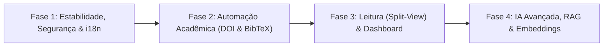

# Lexicon — Plano Estratégico de Evolução em Fases

> **Documento:** PLANO.md  
> **Aplicação:** Lexicon v4_AI (Intelligent Research Library & Document Manager)  
> **Princípio Norteador:** *Local-first*, *Zero-build*, sem reinventar a roda, aproveitando as capacidades nativas do navegador e reservando a **última fase exclusivamente para IA Avançada, RAG e Embeddings**.

---

## 🧭 Sumário das Fases



---

## 📌 Esclarecimento Prévio: O Item 3.4 (Visualizador Integrado)

> [!IMPORTANT]
> **Você não precisa criar nenhum parser! Criar um parser de PDF do zero seria reinventar a roda de forma inviável.**

### Como funciona a Leitura sem Criar Parser:
Hoje, quando o usuário clica em **READ**, o Lexicon executa:
```javascript
const objectUrl = URL.createObjectURL(storedFile);
window.open(objectUrl, '_blank'); // Abre em uma aba externa separada
```
Isso força o pesquisador a ficar alternando abas (`Alt + Tab` ou clicando) entre o PDF na aba externa e o Lexicon para digitar o fichamento.

### A Solução Nativa (Zero Parsers, Zero Bibliotecas Pesadas):
Em vez de abrir em uma aba externa, o Lexicon pode simplesmente renderizar um modal maximizado ou modo tela cheia em **Split-View (Tela Dividida)**:

```
+------------------------------------------+----------------------------------+
|      LADO ESQUERDO (60% da tela)         |   LADO DIREITO (40% da tela)     |
|                                          |                                  |
|   <iframe src="blob:http://..." />       |   EDITOR DE FICHAMENTO (NOTAS)   |
|                                          |                                  |
|   (O leitor nativo do Chrome/Firefox     |   - Resumo e Metadados           |
|    renderiza o PDF com GPU, zoom,        |   - Botão "Inserir Citação"      |
|    busca Ctrl+F e seleção nativa)        |   - Campo Markdown com toolbar   |
|                                          |   - Auto-save contínuo           |
+------------------------------------------+----------------------------------+
```

* **Zero Código de Parsing:** O próprio motor nativo do navegador (PDFium no Chrome/Edge ou PDF.js embutido no Firefox) cuida de 100% da renderização, zoom, nitidez vetorial e texto.
* **Ganho Imediato:** O usuário lê o documento original de um lado e escreve o fichamento do outro lado na mesma janela.

---

## 🚀 FASE 1: Estabilidade, Segurança & Padronização de Idioma (i18n) `[Status: ✅ CONCLUÍDO]`

> **Acompanhamento Detalhado:** Veja o checklist item a item em [tasks.md](file:///home/pedro/Dev/Playground/util/research_library_manager/v5/tasks.md).

**Objetivo:** Eliminar bugs silenciosos de JavaScript, garantir robustez na manipulação de strings e padronizar o idioma de toda a aplicação (Item 4.5).

### Ações:
1. **Correção Definitiva de Escaping de Aspas:**
   * Atualizar `window.Lexicon.Utils.escapeHTML` em `js/app.js` para tratar aspas simples (`'`) e aspas duplas (`"`):
     ```javascript
     escapeHTML(str) {
         if (str === null || str === undefined) return '';
         return String(str)
             .replace(/&/g, '&amp;')
             .replace(/</g, '&lt;')
             .replace(/>/g, '&gt;')
             .replace(/"/g, '&quot;')
             .replace(/'/g, '&#39;');
     }
     ```
2. **Eliminação de Handlers Inline com Interpolação Frágil:**
   * Substituir chamadas como `onclick="Lexicon.Collections.toggleSidebarCollectionExpand('${col.name}')"` por atributos `data-collection-name` e **Event Delegation** nos containers de listas.
3. **Consistência de Estado e Limpeza de Filtros:**
   * Garantir que, ao trocar de coleção ou categoria, os filtros ativos de tags e buscas pendentes sejam limpos sem inconsistências no histórico do `navigation.js`.
4. **Padronização e Internacionalização de Idioma (Item 4.5):**
   * Resolver a mistura atual entre inglês (*"All Documents", "Inbox", "Reading List", "Summary & Abstract"*) e português da IA (*"Resumir com IA", "Estruturar Notas", "Bibliotecário IA"*).
   * Implementar um dicionário leve (`js/i18n.js`) com alternância direta de idioma (Português PT-BR e Inglês EN-US) ou padronização integral em Português, unificando menus, cabeçalhos, formulários, alertas e prompts do Bibliotecário IA.

---

## 📚 FASE 2: Automação Acadêmica & Produtividade (DOI & Citações) `[Status: ✅ CONCLUÍDO]`

**Objetivo:** Transformar o Lexicon em uma ferramenta indispensável de produtividade científica, eliminando digitação manual de metadados e facilitando a escrita de artigos/monografias.

### Ações:
1. **Lookup Automático de Metadados via DOI (CrossRef API Aberta):**
   * Sem necessidade de chaves de API nem login: a CrossRef disponibiliza `https://api.crossref.org/works/{doi}` de forma pública e gratuita.
   * Adicionar botão **"Buscar Metadados"** ao lado do campo DOI:
     * Preenche automaticamente: Título oficial, lista de autores formatada, revista/conferência, volume/edição, ano e abstract original.
     * Suporte também a identificadores arXiv (`https://export.arxiv.org/api/query?id_list={id}`).
2. **Gerador e Exportador de Citações BibTeX (`.bib`):**
   * Função para gerar entrada BibTeX limpa a partir dos metadados do artigo.
   * Botão de exportar `.bib` individual no Inspector.
   * Ação em lote na barra flutuante: *"Exportar Selecionados como BibTeX (.bib)"*.
3. **Cópia Rápida de Referência Formatada:**
   * Botão de 1 clique para copiar nos padrões acadêmicos mais usados:
     * **ABNT NBR 6023** (Padrão brasileiro para TCC, dissertações e teses).
     * **APA 7ª edição** (Padrão internacional mais exigido em periódicos).
     * **Chicago / Vancouver** (para áreas de humanas ou biomédicas).
4. **Interoperabilidade com Zotero e Mendeley (Exportação RIS):**
   * Exportação no padrão `.ris` para permitir migração bidirecional simples.

---

## 📖 FASE 3: Experiência de Leitura (Split-View), Zettelkasten & Dashboard Analítico `[Status: ⏳ PENDENTE]`

**Objetivo:** Criar um ambiente de leitura imersivo integrado (sem parsers), conectar anotações através de Wikilinks (Zettelkasten), suportar leitura de livros EPUB e fornecer métricas visuais completas sobre a produtividade científica do pesquisador.

### Ações:
1. **Modo Split-View no Inspector / Leitor (Item 3.4):**
   * Opção de alternar entre *Modo Fichamento Padrão* e *Modo Leitura Lado a Lado (Split-View)* com leitor nativo via `<iframe>` à esquerda (60%) e editor de notas em Markdown à direita (40%).
2. **Extração Real de Texto de PDFs via Web Worker (`pdf.js` extractor) (Item 3.1):**
   * Web Worker que lê as primeiras páginas do PDF no navegador e extrai metadados embutidos e o texto cru do abstract/resumo para alimentar o "Resumir com IA".
3. **Rede de Notas Conectadas & Zettelkasten (`[[Wikilinks]]`) (Item 3.5):**
   * Autocomplete de títulos de artigos ao digitar `[[` no editor.
   * Renderizador de `[[ID_ou_Titulo]]` como links clicáveis e painel de citações reversas (Backlinks).
4. **Suporte a Leitura de Livros EPUB (`epub.js`) (Item 3.6):**
   * Visualizador embutido para arquivos `.epub` com controle de paginação, temas (claro/escuro/sépia) e índice de capítulos.
5. **Atalho de Citação Rápida:**
   * Adicionar no topo do editor de notas o botão *"Adicionar Bloco de Citação"* (`> "..."`) com data e número de página preenchível.
6. **Download e Exportação Consolidada do Fichamento:**
   * Exportar o fichamento completo já estruturado com os dados bibliográficos em um arquivo `.md` pronto para Obsidian, Notion ou Logseq.
7. **Dashboard de Métricas & Produtividade Científica (Item 4.4):**
   * Nova visão no menu lateral **"Estatísticas & Insights"** com micro-gráficos SVG nativos (Pipeline Funnel, ritmo de leitura mensal/anual, nuvem de tópicos e tempo médio de permanência).

---

## 🤖 FASE 4 (ÚLTIMA FASE): Inteligência Artificial Avançada, RAG, Embeddings & Evolução do Agente `[Status: ⏳ PENDENTE]`

**Objetivo:** Evoluir o Bibliotecário IA atual de tarefas mecânicas isoladas para um assistente de pesquisa profundo, com conversação, streaming em tempo real e busca semântica real baseada em vetores (RAG local).

### Ações:
1. **Streaming em Tempo Real (Server-Sent Events / ReadableStream):**
   * Alterar a chamada ao Ollama (`/api/generate` e `/api/chat`) para `stream: true`.
   * Implementar leitor de chunks em tempo real: o texto do resumo e do fichamento vai surgindo imediatamente na tela (efeito máquina de escrever), acabando com a sensação de travamento.
2. **Painel de Chat com o Artigo ("Pergunte ao Documento"):**
   * Nova aba no Inspector com interface de conversação direta.
   * O pesquisador pode fazer perguntas específicas ao modelo local:
     * *"Qual foi o método estatístico usado neste artigo?"*
     * *"Quais são as principais limitações apontadas pelos autores nas conclusões?"*
     * *"Resuma as 3 teses centrais em bullets rápidos."*
3. **Embeddings Locais com Modelo Especializado (ex: `nomic-embed-text`):**
   * Utilizar a API do Ollama (`/api/embeddings`) para gerar vetores numéricos de 768 dimensões para cada artigo (baseado no título, abstract e notas).
   * Armazenar os vetores diretamente no IndexedDB do Lexicon (`LexiconFilesDB`).
4. **Busca Semântica Real (RAG Local):**
   * Em vez de traduzir a pergunta para um filtro literal de `.includes()`, o sistema gera o embedding da pergunta do usuário e calcula a **similaridade de cosseno** contra o acervo.
   * Resultado: se o usuário buscar *"técnicas de reflorestamento em áreas secas"*, o sistema encontra artigos sobre *"restauração ecológica no semiárido"* mesmo que não compartilhem uma única palavra literal idêntica.
5. **Onboarding e Diagnóstico Inteligente do Ollama:**
   * Assistente visual no modal de configurações da IA para usuários que ainda não iniciaram o Ollama, fornecendo o comando exato de terminal para copiar e colar conforme o sistema operacional.

---

## 📊 Matriz Consolidada de Execução

| Fase | Título | Complexidade | Itens Cobertos do Relatório | Foco Principal |
| :--- | :--- | :--- | :--- | :--- |
| **Fase 1** | Estabilidade, Segurança & i18n | Baixa | Item 4.1 e Item 4.5 | Correção de aspas, Event Delegation e padronização de idioma (PT-BR / EN) |
| **Fase 2** | Automação Acadêmica | Média-Baixa | Item 3.2 e Item 3.3 | Lookup automático por DOI (CrossRef), Citações ABNT/APA, Exportação BibTeX |
| **Fase 3** | Leitura (Split-View) & Dashboard | Média | Item 3.4 e Item 4.4 | Leitura lado a lado sem parsers (`<iframe>`) e Dashboard de Produtividade em SVG |
| **Fase 4** | IA Avançada, RAG & Embeddings | Alta | Item 4.2 e Item 4.3 | Streaming de tokens, Chat com o Paper, Embeddings locais e Busca Vetorial |
